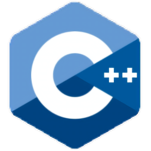
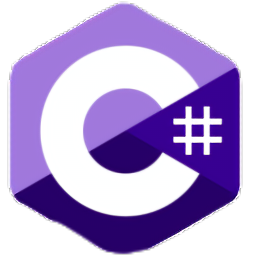
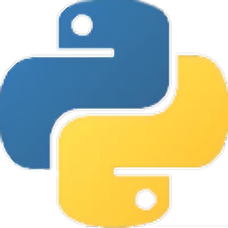
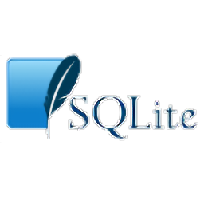

### Hi everyone! I’m Katerina Lishchuk!

- Currently learning **SQLite** and improving my backend skills
- Writing code in **C++**, **C#**, and **Python**
- Goal: *Learning to be better than yesterday*

### Languages & Tools

  
  &nbsp;&nbsp;
  
  &nbsp;&nbsp;
  
  &nbsp;&nbsp;
  

