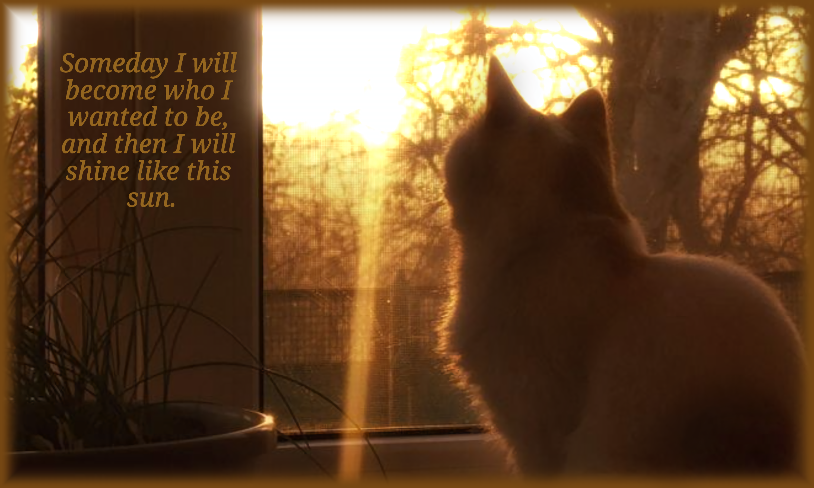

### Hi everyone! I’m Katerina Lishchuk!

- Currently learning **SQLite** and improving my backend skills
- Writing code in **C++**, **C#**, and **Python**
- Goal: *Learning to be better than yesterday*

### Core Skills

  <!--  -->
  

- **languages:** Python • C++ • C# • Ren'Py Script • SQL • HTML • CSS
- **databases:** SQLite
- **tools & hardware:** Arduino • Git

